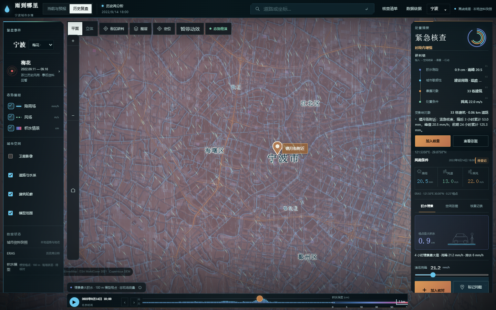
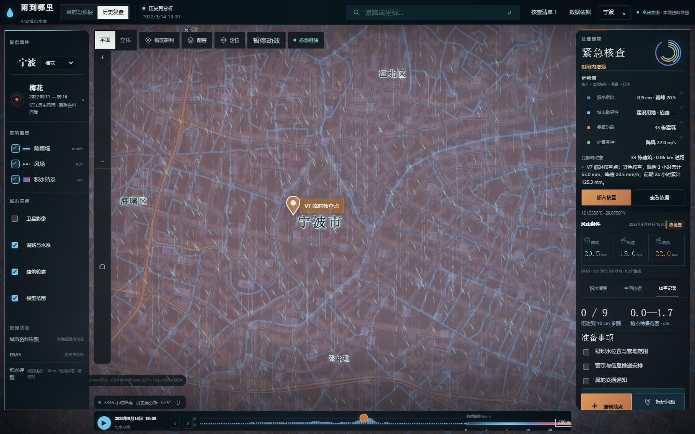
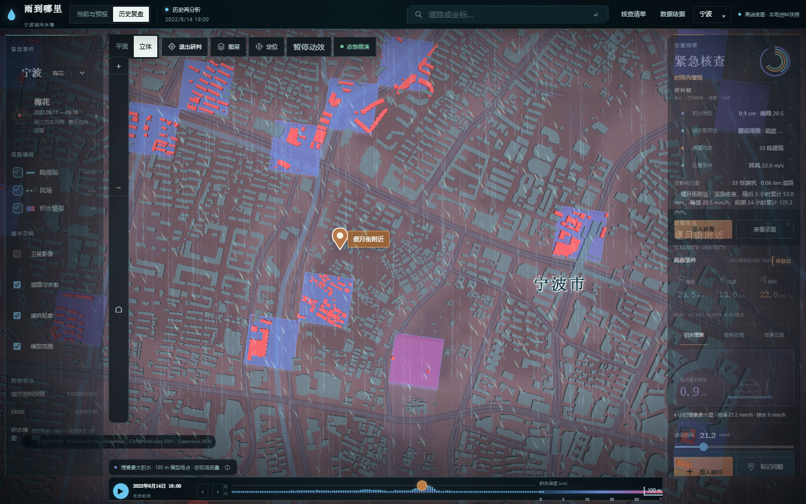

# 汛维 XUNWEI

> 城市洪涝时空智能研判系统｜AI4Climate 2026

汛维把台风风雨、积水情景、城市暴露对象与人工核查组织进同一条可解释的时空研判链。项目以宁波为原型城市，面向社区、物业和基层防汛值守场景；它用于汛前准备、历史复盘和地点核查，不替代属地气象、水利与应急部门的正式预警。



## 产品链路

```text
风雨输入 → 积水情景 → 道路/建筑暴露 → 行动判断 → 地点核查与交接
```

- 历史台风复盘与当前/预报气象
- 动态降雨、风场和积水图层
- 平面、立体与街区三种研判视角
- 道路、建筑与模型水体的空间关联
- 地点搜索、登记、核查清单与情景保存
- 断网时保留本地资料与确定性规则摘要



## 模型与边界

高成本训练标签由 Landlab OverlandFlow / de Almeida 局部惯性方法生成，计算域为 129 × 129 个格点、间距约 180 米。RBF Kernel Ridge 代理模型把雨峰与等效排水参数映射为四小时最大水深场；完整演算按 77 / 12 / 24 划分为训练、选参与独立测试，测试 RMSE 为 0.6214 mm。

这些指标衡量代理模型对物理模拟器的近似，不代表现场积水精度。当地管网、泵站、潮位、入口高程和现场积水真值尚未接入；建筑高亮仅表示与当前模型水体空间相交，不代表已经受灾。



## 运行

需要 Node.js 18 或更高版本。在仓库根目录执行：

```powershell
node static_server.mjs --open
```

完全离线模式：

```powershell
node static_server.mjs --offline --open
```

服务启动后会在终端显示访问地址。公开仓库不包含任何账号、个人联系方式、本机目录或云端服务凭据。未配置可选云端摘要时，系统自动使用本地确定性摘要，核心研判功能不受影响。

## 数据来源

| 数据 | 用途 |
| --- | --- |
| ERA5 / Open-Meteo | 历史与当前风雨信息 |
| IBTrACS CMA | 台风事后最佳路径 |
| Copernicus GLO-30 | 地形与三维地表 |
| WorldCover / Sentinel-2 | 地表类型与影像背景 |
| Overture / OpenStreetMap | 道路、建筑与地理背景 |

完整第三方许可与数据说明见 [`THIRD_PARTY_NOTICES.md`](THIRD_PARTY_NOTICES.md)。

## 验证

```powershell
node --test validation/*.test.mjs
node validation/worker_regression.mjs
node validation/v6-static-contract.mjs
```

公开版本额外包含仓库隐私测试，用于阻止密钥字面量、个人邮箱和 Windows 绝对路径进入提交内容。

## 安全

请勿把 `.env`、访问令牌、API Key、个人联系方式、浏览器资料目录或本机绝对路径提交到仓库。安全约定见 [`SECURITY.md`](SECURITY.md)。

